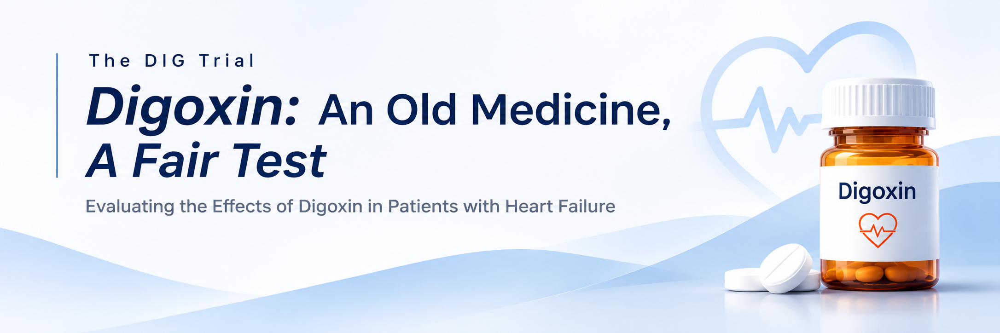
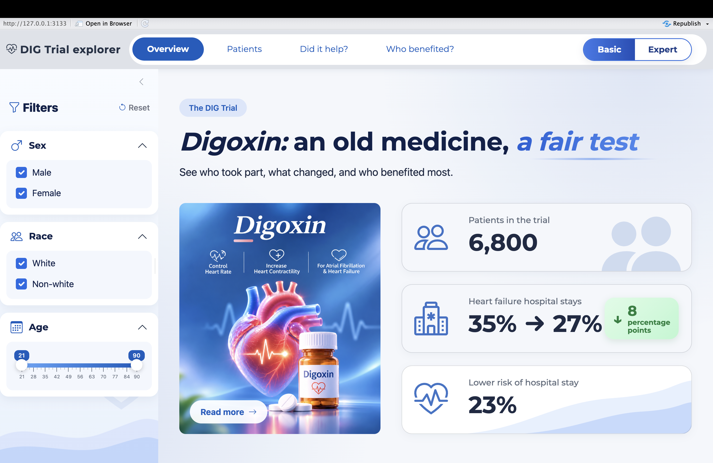
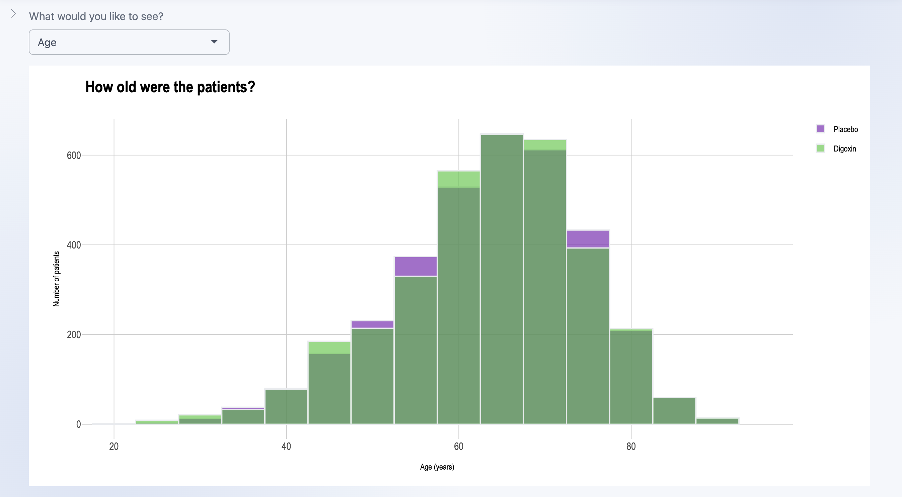
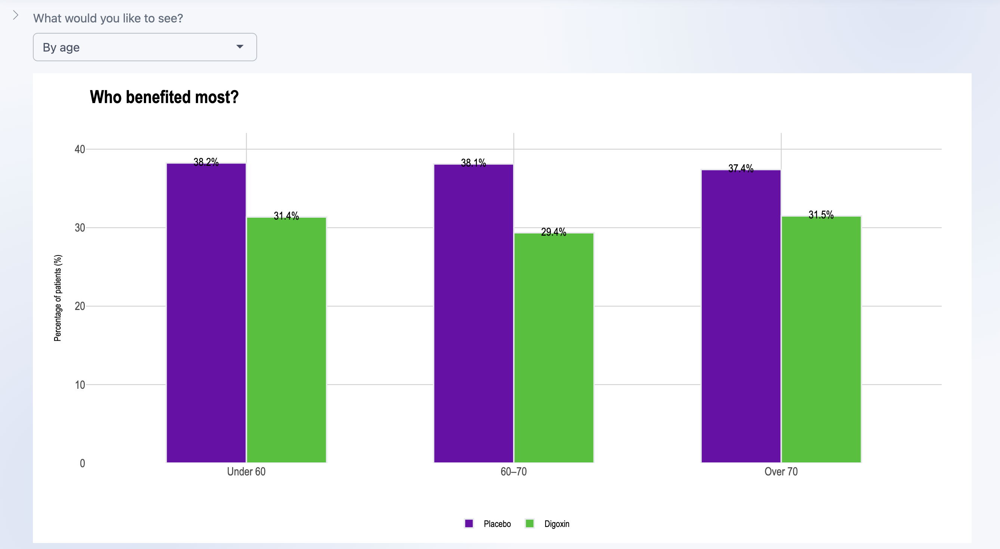

# DIG Trial Explorer

An interactive Shiny app that turns the Digitalis Investigation Group (DIG) trial into clear, explorable charts. In the trial, 6,800 people with heart failure were randomly given either digoxin or a placebo. The app shows who took part, what changed, and who benefited most.

## Overview

The app has two modes. **Basic** mode is written for non-specialists: it explains the trial's findings in plain language, using simple histograms and bar charts. **Expert** mode is for readers who want more detail, including statistical tests and effect estimates. Use the Basic / Expert switch in the top-right corner to move between them.

Below is a preview of the Basic mode home page.

## Basic mode: two simple charts

Basic mode is designed for people with no medical or statistics background. To keep it simple and easy to read, it uses only two familiar chart types: histograms and bar charts. Most people have seen these before, so readers can focus on what the data shows rather than on learning how to read the chart.

**Histograms** show who the patients were. When the digoxin and placebo groups overlap, it means the two groups were similar at the start, so the comparison is fair.

**Bar charts** show what happened. Placing the two groups side by side makes the difference easy to see at a glance.

Hover over any chart to see the exact numbers.
